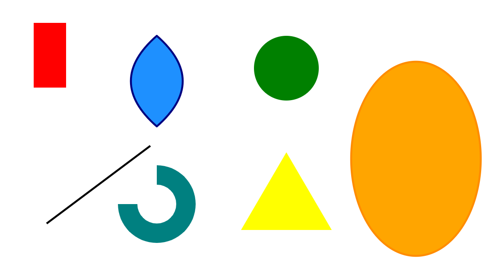
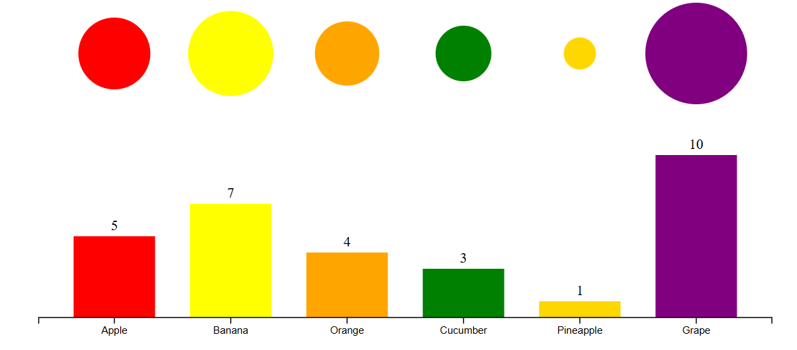
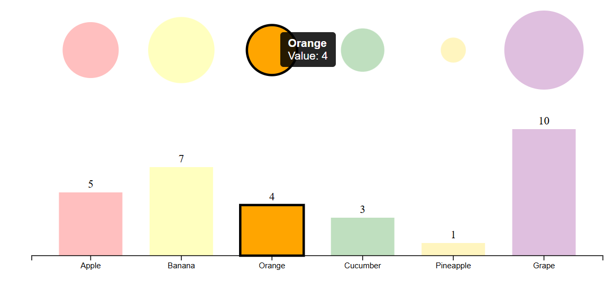

# A1: Hello World, GitHub and d3

## Overview

This assignment covers the full workflow of a basic web visualization project: a GitHub repository, a pull request, a page that loads d3 from a CDN, and graphics drawn with JavaScript.

The project has two parts, both drawn into the `#container` div in `index.html`:

1. **A shape gallery** of SVG graphics primitives and a few extra shapes, each in a different color.
2. **An interactive linked-views chart** that shows the same small fruit dataset as bubbles and as bars. Hovering over either one highlights the matching item in both, and a tooltip shows its details.

**Files**

| File | Purpose |
|------|---------|
| `index.html` | Loads d3 from the jsDelivr CDN, logs the d3 version to the console as a load check, and includes `a1.js` |
| `a1.js` | All of the d3 code for the shapes, linked views, interaction and animation |

**Live page:** https://adis89096.github.io/a1-ghd3/

### Screenshots

**Shape gallery**

**Linked views (default state)**

**Linked views (hovering over "Orange")**

---

## The Four Graphics Primitives

Each primitive is appended to a single 800 x 420 SVG with `svg.append(...)` and styled with `.attr(...)`.

| Primitive | Color | What it looks like | Key attributes |
|-----------|-------|--------------------|----------------|
| **Rectangle** | Red | A tall rectangle at the top left | `x=60, y=40, width=50, height=100` |
| **Circle** | Green | A solid circle at the top right of center | `cx=450, cy=110, r=50` |
| **Line** | Black | A diagonal line at the bottom left, 3px thick | `(80,350)` to `(240,230)`, `stroke-width=3` |
| **Polygon** | Yellow | A triangle at the bottom center | `points="380,360 450,240 520,360"` |

---

## Task Descriptions

### Tech1: Additional Shapes

Beyond the four required primitives, I added three more shapes:

- **Path (blue lens):** drawn with a custom path string, `M 250 60 Q 330 130 250 200 Q 170 130 250 60 Z`. Two quadratic curves form a leaf or lens shape. It has a `dodgerblue` fill and a navy stroke.
- **Ellipse (orange):** a large ellipse centered at `(650, 250)` with `rx=100` and `ry=150`. It has an orange fill and a dark orange outline.
- **Arc (teal):** built with d3's `d3.arc()` generator, with `innerRadius(30)`, `outerRadius(60)` and an angle from `0` to `1.5π`. This makes a three-quarter ring. It is moved into place with `translate(250, 320)`.

The arc differs from the other shapes because d3 generates its path data, rather than me writing the coordinates by hand.

### Tech2: Complex Implementation (Linked Views)

I built a **linked-views visualization** from one dataset of six fruits (Apple, Banana, Orange, Cucumber, Pineapple, Grape). Each record has a name, a value and a color. The data is shown in two views:

- **View 1, bubbles:** one circle per fruit, with the circle's size showing its value.
- **View 2, bars:** a bar chart of the same values with an x-axis labeled by fruit name.

The views share d3 scales so they line up and agree with each other:

- `d3.scaleBand()` puts each fruit in the same horizontal slot in both views.
- `d3.scaleSqrt()` maps value to bubble radius. A square-root scale makes the circle's *area*, not its radius, proportional to the value, so large values are not exaggerated.
- `d3.scaleLinear()` maps value to bar height.

The linking is done by two small functions, `highlight(name)` and `reset()`. Each one updates the bubbles and the bars together by looping over `[bubbles, bars]`. `highlight` fades every other item to 25% opacity and puts a black outline on the selected one. `reset` returns everything to normal.

### Tech3: Other (Tooltips, Labels, Hover and Animation)

I added several interaction and polish features:

- **Hover interaction:** `mouseover`, `mousemove` and `mouseout` handlers are attached to both bubbles and bars, so hovering over either view triggers the linked highlight.
- **Tooltip:** a custom `div` appended to `body` shows the fruit's name in bold and its value. It follows the cursor with `mousemove` (offset slightly so it does not cover the pointer) and fades in and out with opacity. I set `pointer-events: none` on it so it never interferes with the hover.
- **Value labels:** each bar has its value printed above it, centered with `text-anchor: middle`. These labels also have `pointer-events: none` so they do not block hover on the bars.
- **Entrance animation:** bars grow up from the baseline and bubbles grow out from zero radius over 1 second. A staggered delay of `i * 150` ms makes the items appear one after another from left to right.

---

## Technical Achievements

- Used d3 selections and the `.data().join()` pattern to create the bars, bubbles and labels from a single array, rather than hand-writing each element.
- Used three kinds of d3 scales (`scaleBand`, `scaleSqrt`, `scaleLinear`) and chose each one for the job it fits best.
- Used a d3 generator (`d3.arc()`) and a hand-written path with Bezier curves, in addition to basic SVG elements.
- Implemented **linked views** with one shared function that updates several selections at once, so the two views stay in sync and the logic is written only once.
- Built a **custom HTML tooltip** positioned with `event.pageX` and `event.pageY`, with correct handling of pointer events.
- Used d3 **transitions** with staggered delays, and the d3 axis helper (`d3.axisBottom`) for the bar chart's labels.
- Loaded d3 from a CDN and added a `console.log` of `d3.version` to confirm that the library loaded.

## Design Achievements

- **Consistent color coding:** each fruit keeps the same color in both views, so a viewer can match a bubble to its bar without reading the labels.
- **Honest size encoding:** the bubbles use a square-root scale so that area, which is what the eye compares, matches the data.
- **Clear focus on hover:** fading the other items and outlining the selected one makes the highlighted fruit stand out, in both views at once.
- **Direct labeling:** values are printed on the bars and the tooltip gives exact numbers, so viewers do not need to estimate from bar height.
- **Smooth, staggered entrance:** the animation draws the eye across the chart from left to right and makes the page feel polished.
- **Colorful and varied shape gallery:** the shapes use distinct colors, sizes and strokes and are spread across the canvas, so the page is lively and every shape is easy to tell apart.
